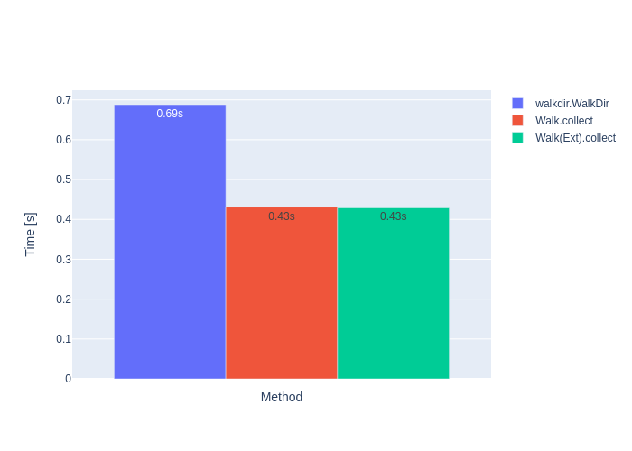
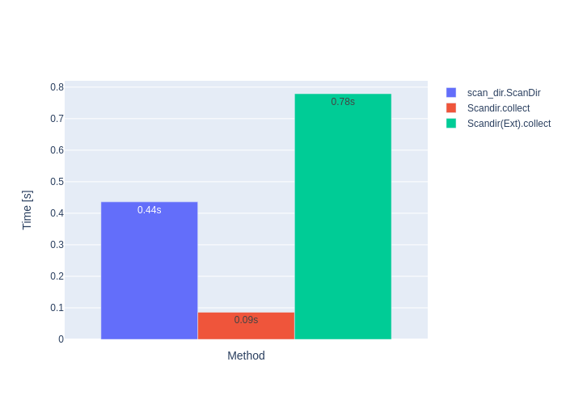

# `scandir-rs`

`scandir-rs` provides fast directory iteration, like `os.walk()` or `os.scandir()`,
with more features and **HIGHER** speed. The project includes a [Rust](scandir/README.md)
crate and a [Python](pyscandir/README.md) module, as well as bindings for C, C++,
Go, Java, and C#.

Depending on the API, it yields paths, entries grouped by type, or `DirEntry`
objects containing file type and stat information. Directory iteration is
**many** times faster than `os.walk()`, `os.scandir()`, `walkdir`, or `scan_dir`
(see **benchmarks** for [Rust benchmarks](https://github.com/brmmm3/scandir-rs/blob/master/scandir/doc/benchmarks.md)
and [Python benchmarks](https://github.com/brmmm3/scandir-rs/blob/master/pyscandir/doc/benchmarks.md)).




The higher performance is achieved through parallelizing the file system access for reducing the
 access delay because of the overhead each file access has.

**Note:** `scandir_rs` uses libc 2.34, which is currently not supported by the manylinux releases.
 So it is not possible to upload prebuilt Linux wheels to PyPI. As a workaround you can download
 the Linux wheels from [github](https://github.com/brmmm3/scandir-rs/releases/tag/2.7.0).

**Note:** Since 2.8.0 `skip_hidden` is now `false` by default!

## Language bindings

Bindings expose common directory-scanning options such as sorting, hidden-file
handling, depth and file-count limits, glob filters, link following, and basic
or extended metadata. Option coverage varies by binding; see each module's
README for build requirements, API details, and runnable examples.

| Language / interface | Implementation | Documentation |
| --- | --- | --- |
| Rust | Native crate API, including background workers and timed result collection | [Rust guide](scandir/README.md) |
| Python | PyO3 module; the published wheel includes type stubs | [Python guide](pyscandir/README.md) |
| C | C ABI with collect and count operations | [C guide](cscandir/README.md) |
| C++ | Rust bindings through the `cxx` bridge | [C++ guide](cxxscandir/README.md) |
| Go | cgo wrapper around the C ABI | [Go guide](goscandir/README.md) |
| Java | JNI and Foreign Function & Memory API wrappers targeting Java 25 LTS around the C ABI | [JNI guide](jscandir-jni/README.md), [FFM guide](jscandir-ffm/README.md) |
| C# | .NET P/Invoke wrapper around the C ABI | [C# guide](csharpscandir/README.md) |

The C ABI provides synchronous `collect` and `count` calls, not a native
`walk` endpoint. Wrappers that provide a walk-style view using this ABI build
it from collected entries; the Rust and C++ APIs can use the Rust walk
implementation directly. Rust and Python also support timeout-bounded
collection and timed result retrieval.

The project is dual-licensed under [MIT](LICENSE-MIT) or
[Apache-2.0](LICENSE-APACHE).

## Python examples

### Count

Get statistics of a directory:

```python
from scandir_rs import Count, ReturnType

print(Count("/usr", return_type=ReturnType.Ext).collect())
```

The `collect` method releases the GIL. So other Python threads can run in parallel.

The same, but asynchronously in background using a class instance:

```python
from scandir_rs import Count, ReturnType

instance = Count("/usr", return_type=ReturnType.Ext)
instance.start()  # Start scanning the directory in background
...
values = instance.results()  # Returns the current statistics. Can be read at any time
...
if instance.busy():  # Check if the task is still running.
...
instance.stop()  # If you want to cancel the task
...
instance.join()  # Wait for the instance to finish.
```

and with a context manager:

```python
import time

from scandir_rs import Count, ReturnType

with Count("/usr", return_type=ReturnType.Ext) as instance:
    while instance.busy():
        statistics = instance.results()
        # Do something
        time.sleep(0.01)
    print(instance.results())
```

### Walk

```python
from scandir_rs import Walk

for root, dirs, files in Walk("/usr"):
    # Do something
```

#### with extended metadata

```python
from scandir_rs import Walk, ReturnType

for root, dirs, files, symlinks, other, errors in Walk("/usr", return_type=ReturnType.Ext):
    # Do something
```

### Scandir

```python
from scandir_rs import Scandir, ReturnType

for path, entry in Scandir("~/workspace", return_type=ReturnType.Ext):
    # entry is a custom DirEntry object
```

or collecting all the result:

```python
from scandir_rs import Scandir, ReturnType

instance = Scandir("~/workspace")
instance.extended(True)
results = instance.collect()
```

## Rust examples

### Count

```rust
let mut instance = Count::new(&root_dir)?;
// Exclude directories dir0 and dir1
instance = instance.dir_exclude(Some(vec!["dir0".to_owned(), "dir1".to_owned()]));
// Use extended metadata for calculating statistics
instance = instance.extended(true);
// Start and wait for finishing background worker thread.
// collect checks if background thread is already running. If not it will be started.
let statistics = instance.collect()?;
```

### Walk

```rust
let mut instance = Walk::new(&root_dir, None)?;
// Use extended metadata for calculating statistics
instance = instance.extended(true);
// Start background thread for traversing file tree
instance.start()?;
loop {
    if !instance.busy() {
        break;
    }
    // Do something...
    thread::sleep(Duration::from_millis(10));
}
let result = instance.collect()?;
```

### Scandir

```rust
let mut instance = Scandir::new(&root_dir, None)?;
// Use extended metadata for calculating statistics
instance = instance.extended(true);
// Start background thread for traversing file tree
instance.start()?;
loop {
    if !instance.busy() {
        break;
    }
    // Do something...
    thread::sleep(Duration::from_millis(10));
}
let result = instance.collect()?;
```
